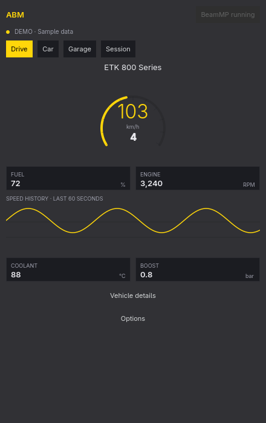

# ABM: Advanced BeamNG.Drive Manager

ABM is a native, local-first manager for **BeamNG.drive and BeamMP**. Launch the game, watch live telemetry, browse your garage, and try sandbox tuning, all from one app. It's built with C++ and Qt Quick, and you can add an optional widget to your Omarchy bar.

**Latest preview: [0.13.0](https://github.com/DauphinDM/ABM/releases/tag/v0.13.0).** The source is public under the MIT license, with downloads for Linux and Windows. ABM is an independent project, not affiliated with BeamNG or BeamMP. Gameplay integration and Windows support are still experimental. Passing CI doesn't mean every feature has been tested in a live game.

**New in 0.13.0:** [ABM Mobile](https://github.com/DauphinDM/ABM-Mobile) and a fifth **Connect** screen. If you opt in, you can control ABM from your phone over your private Wi-Fi with an encrypted connection. See [pairing, requirements, and limits](docs/mobile-companion.md). This release also adds [opt-in update checks and verified downloads](docs/updates.md). Installation is still platform-specific.

## What it does

| Page | Features |
| --- | --- |
| **Drive** | Speed and RPM gauge, gear, fuel, speed history, coolant, boost, warnings |
| **Car** | Power entry, engine strength and protection, gravity, grip, brakes, steering, manual gears, ESC, bounce start/stop, experimental width/length/height, repair, fire, and tires. Safe extra gears and own-car multiplayer resizing need bridge 0.6.2. Resizing is not synchronized to other players. |
| **Garage** | Filter by vehicle type, stock/mod/custom content, favorites, and nine metadata fields. Sort models and configs, preview photos, and confirm spawn or replace. |
| **Session** | Trip time and distance, top and average speed, FPS history, searchable multiplayer players, and owned vehicles |

Diagnostics show temperature, pedals, steering, G forces, frame times, and timing estimates when the game supplies them. If a reading is missing, ABM leaves it unavailable instead of making one up. Photos come from your own installation, not from a download.

The dashboard uses calm dark surfaces, larger instruments, and photo cards, and it follows your live Omarchy accent. On wide windows, the tabs become a sidebar. Garage filters open in their own dialog so the vehicle grid stays usable. Square corners, plain text, and keyboard navigation still work as before. English is included. The standalone app works without Omarchy. Windows support is still experimental.

The Car workshop groups related controls into **Engine & protection**, **Handling & gearbox**, **World & recovery**, and **Body · experimental**. Controls turn off when the vehicle doesn't support them, when the car is moving, when an input is invalid, or when server policy blocks the action. Install the updated bridge files and restart BeamNG when you're ready to receive capability data. New live-power controls, actual-gear readback, and full reset need bridge 0.9.0 or newer. See the [foundation guide](docs/workshop-foundation.md). Bridge 0.10.0 adds supported combustion-engine RPM limits, friction-clutch protection, and same-vehicle reset recipes. See [reset persistence and RPM](docs/reset-persistence.md) for compatibility and safety limits. These features are experimental. They are not whole-car invulnerability.

## Documentation

See the [changelog](CHANGELOG.md) for features, limits, and validation status.

- [Installation and migration](docs/installation.md)
- [User guide, tuning behavior, and shortcuts](docs/user-guide.md)
- [CLI reference](docs/cli.md)
- [Architecture and compatibility](docs/architecture.md)
- [Troubleshooting](docs/troubleshooting.md)
- [Windows build and limitations](docs/windows.md)
- [Android/iOS companions and private-Wi-Fi pairing (development)](docs/mobile-companion.md)
- [Portable Linux: AppImage and bundled archive](docs/portable-linux.md)
- [Sandbox feature research and roadmap](docs/sandbox-research.md)
- [Official-server allowlist, cleanup, and limitations](docs/server-policy.md)
- [Development, tests, and releases](docs/development.md)
- [Visual audit](docs/ui-audit.md)
- [Design-to-code review and preview reliability](docs/design-review.md)
- [Security and privacy](SECURITY.md)
- [Changelog](CHANGELOG.md)

## Quick start on Arch Linux / Omarchy

Install the release's `abm-0.13.0-1-x86_64.pkg.tar.zst` asset:

```sh
sudo pacman -U abm-0.13.0-1-x86_64.pkg.tar.zst
abm-enable --json
abm open
```

`abm-enable` sets up **Omarchy integration**. On other Linux desktops, use **Options → Paths & bridge setup** in the standalone app instead.

Check that you've selected your active BeamNG user folder (the one that contains `beamng.log`), install the bridge, and restart BeamNG when convenient. The app never restarts a running game for you. Installing ABM does not install BeamNG or BeamMP.

On Omarchy, open **ABM** from the launcher. Left-click the bar widget to start BeamNG when it's closed or to see quick stats when it's running. Right-click to open the dashboard. If the dashboard is already open, ABM focuses it instead of opening a second copy.

### Build from source

You'll need a C++17 compiler, make, Qt 6 (base, declarative, Quick Controls, Wayland, and SVG runtime support), libarchive, and qmake6. The full test suite also needs Python 3, Node.js, and LuaJIT. Linux build scripts use `flock`.

```sh
gh repo clone DauphinDM/ABM
cd ABM
./bin/build
./bin/test
./build/abm open --demo
./bin/install
```

Other Linux desktops can use the [AppImage or portable archive](docs/portable-linux.md). Windows users can extract the [standalone ZIP](docs/windows.md). Keep its DLLs next to `ABM.exe`.

## Tuning is a sandbox

Use **Apply tuning** after you move sliders or change beam protection. Gravity preset buttons apply immediately and affect **the whole world**, not just your vehicle. Power scales engine torque curves. It doesn't guarantee a measured horsepower value, and extra torque can break the drivetrain. Beam protection raises beam deformation and strength limits. It does not protect every engine or tire.

The values shown are the last request ABM accepted, not a verified physics readback. Tuning re-applies periodically to the same vehicle, so a normal vehicle reset is not a reliable way to clear it. To restore stock settings, apply 100% power, Earth gravity, and protection off. See the [user guide](docs/user-guide.md).

**Use it only where it's allowed.** ABM is not an anti-cheat bypass. Multiplayer servers may reject or override actions. The new tuning controls still need live verification after you load the bridge. Mocks and automated tests are not a substitute for testing in the real game.

Development 0.7 requires a verified server identity before multiplayer changes. Only the frozen regular-official roster is approved. Official events and new or mismatched official servers are blocked. Verified non-official servers have no extra ABM restriction. Read [policy details and important limitations](docs/server-policy.md).

## Local by design

The bridge sends small, capped JSON messages to `127.0.0.1:44444`. The receiver fetches BeamMP's public HTTPS server directory to classify official servers. It doesn't upload telemetry or the identity of the server you're connected to. There is no ABM cloud service, account login, remote console, arbitrary Lua execution endpoint, or automatic updater. ABM doesn't edit your local game installation or BeamMP-managed files. It installs four bridge files in your **game user folder** and backs up integration files before changing them. See [security boundaries](SECURITY.md).

## Preview status

- **Linux:** built, packaged, and tested with isolated UDP/local sockets and real offscreen QML. The Omarchy widget has been checked on a live desktop.
- **New tuning:** generated vehicle Lua runs in tests, including repeated application and restoring stock beam limits. The actual in-game effects still need live testing.
- **Windows:** the build and deployment workflow is provided. Gameplay and launcher behavior on a clean machine are not certified yet. Don't treat it as stable support.
- **Not included:** a complete ECU or parts editor, persistent named tune profiles, cloud sync, or online mod downloads.

The app is called ABM everywhere. A few **legacy protocol and bridge identifiers** stay for compatibility. [The architecture guide](docs/architecture.md) lists them. The executable, package, service, desktop ID, and widget all use `abm`.

## License

MIT. See [LICENSE](LICENSE). Third-party applications, libraries, and game assets keep their own licenses. ABM does not redistribute BeamNG vehicle archives.
